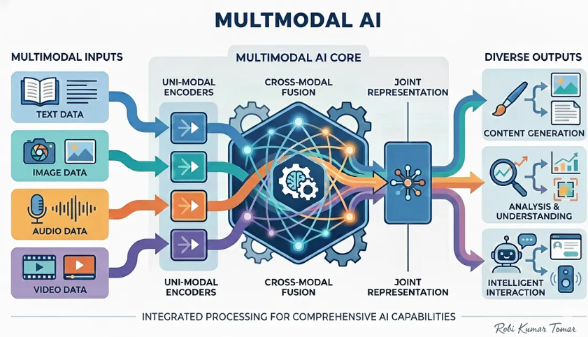
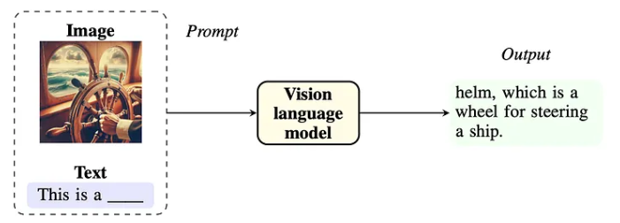
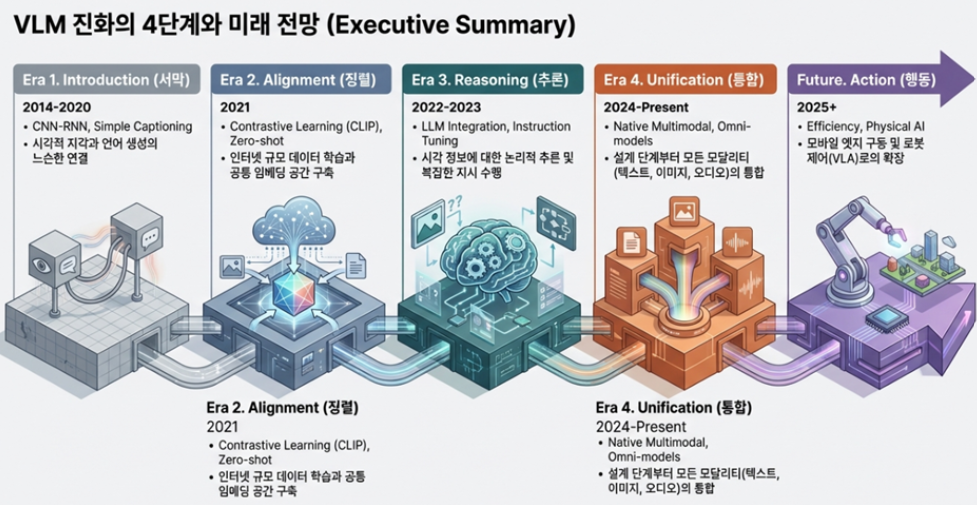
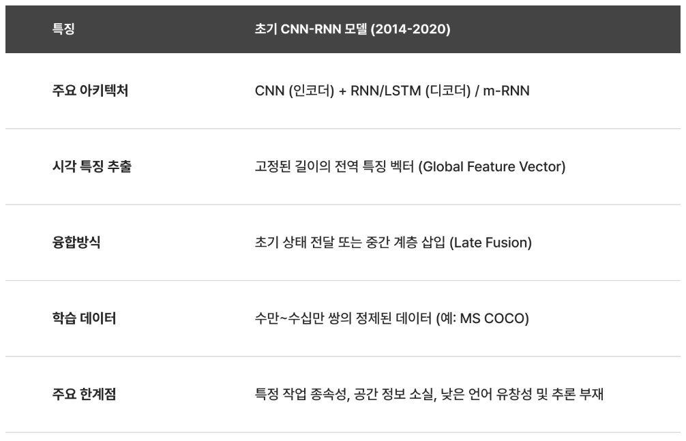
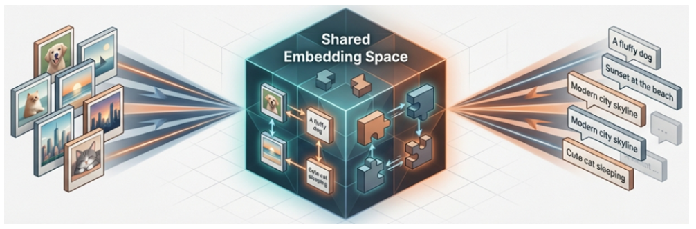
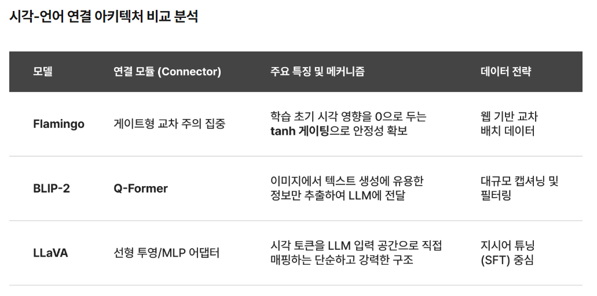
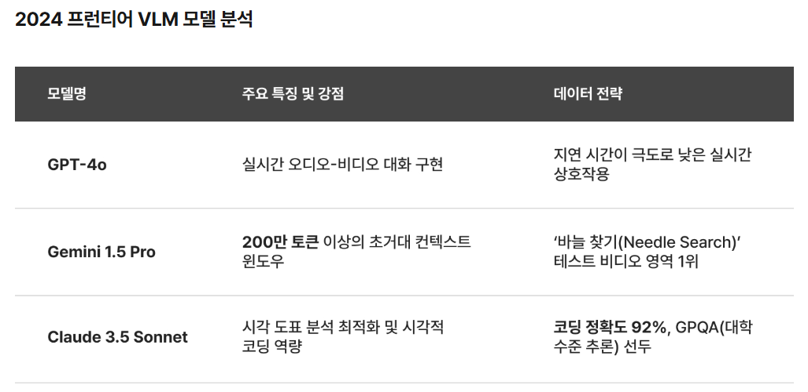
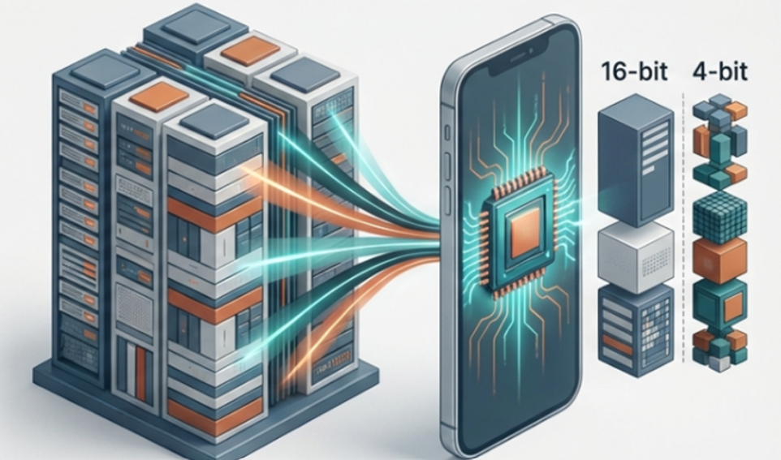
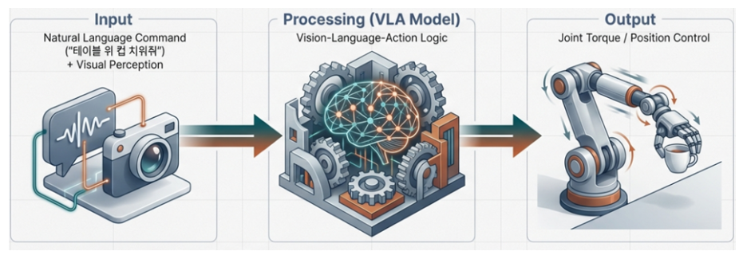

# Multimodal AI 개념

- **여러 종류의 데이터(모달리티)** 를 함께 처리하는 AI
- 사람은 눈(시각), 귀(청각), 텍스트/언어 등 다양한 감각을 통합해 세상을 이해
- Multimodal AI는 이를 모방하여 **텍스트, 이미지, 음성, 영상** 등을 함께 이해·생성

---


---
## 왜 Multimodal이 필요한가?

- 실세계 정보는 텍스트만으로 표현되지 않음
  - 표, 그래프, 스크린샷, 손글씨, 다이어그램 등
- 단일 모달리티 모델의 한계
  - LLM: 시각 정보를 받으면 "설명 텍스트"에만 의존 → 정보 손실
  - Vision 모델: 이미지는 이해하지만 자연어 추론/대화 능력 부족

> Multimodal 모델은 **모달리티 간 정보를 결합해 추론** 가능
  - 예: "이 그래프에서 매출이 가장 높은 달은?" → 이미지+수치 추론 결합

---
## Multimodal AI의 처리 방식 (개념)

```
[이미지] ──▶ Vision Encoder ──▶ Image Embedding
                                         │
[텍스트] ──▶ Tokenizer ──────▶ Text Embedding
                                         │
                                         ▼
                         공통 임베딩 공간에서 결합
                                         │
                                         ▼
                              LLM (Decoder)
                                         │
                                         ▼
                                   텍스트 응답
```

> **VLM** 은 Multimodal AI 중 "Vision + Language"에 특화된 하위 분야

---
# VLM 개요



---
## LLM vs VLM

| 구분 | LLM | VLM |
|---|---|---|
| 입력 모달리티 | 텍스트 | 텍스트 + 이미지(영상) |
| 핵심 구성요소 | LLM (Transformer Decoder) | Vision Encoder + Projector + LLM |
| 학습 데이터 | 텍스트 코퍼스 | 이미지-텍스트 페어, 문서, 영상 등 |
| 대표 태스크 | 요약, 번역, QA, 코드생성 | 이미지 캡셔닝, VQA, OCR, 문서 이해 |
| 대표 모델 | GPT-4, LLaMA, Claude | GPT-4o, Gemini, Qwen2.5-VL |

> VLM은 LLM을 "확장"한 개념 — 언어 이해 능력 위에 시각 이해 능력을 추가

---
### LLM (Large Language Model)이란?
- **텍스트** 를 입력받아 텍스트를 생성하는 대규모 언어 모델
- 예: GPT-4, Claude, LLaMA, Gemini(텍스트 전용 모드)
```
**입력** : 텍스트(prompt)
**출력** : 텍스트(response)
```
**한계**
- 이미지, 영상, 음성 등 시각·청각 정보를 직접 이해하지 못함
- "그림을 설명해줘", "이 표를 읽어줘" 같은 요청 처리 불가

---
### VLM (Vision-Language Model)이란?
- **이미지/영상 + 텍스트** 를 함께 입력받아 이해하고, 텍스트로 응답하는 모델
- 예: GPT-4o, Gemini, Qwen2.5-VL, LLaVA
```
**입력** : 이미지/영상 + 텍스트
**출력** : 텍스트 (경우에 따라 좌표, 이미지 등)
```
**가능한 것**
- 이미지 설명, 시각 질의응답(VQA), 문서/차트 이해, OCR, 영상 이해 등

---
## [VLM 발전 과정](https://laonpeople.com/blog/%EC%8B%9C%EA%B0%81-%EC%96%B8%EC%96%B4-%EB%AA%A8%EB%8D%B8vlm%EC%9D%98-%EC%A7%84%ED%99%94/)

---


---
## VLM 발전 타임라인

| 시기 | 단계 | 핵심 모델/기술 |
|---|---|---|
| 2014~2020 | CNN-RNN 파이프라인 시대 | m-RNN, VGG/ResNet + LSTM/GRU |
| 2021 | 대조 학습의 혁명 | CLIP, SigLIP |
| 2022~2023 | LLM 통합 · Instruction Tuning | Flamingo, BLIP-2, LLaVA |
| 2024 | 네이티브 멀티모달리티 | Gemini 1.5 Pro, GPT-4o |
| 2025~2026 | 실용성 · 신뢰성 강화 | 온디바이스 VLM, 할루시네이션 억제 |
| 2026~ | 피지컬 AI · 자율 에이전트 | VLA (GR00T, π0) |

---
## ① CNN-RNN 파이프라인 시대 (2014~2020)

- **m-RNN** (2014~15, Baidu Research) — 시각과 언어를 최초로 결합한 시도
- 구조: **CNN**(VGG, ResNet)이 이미지를 특징 벡터로 압축 → **RNN**(LSTM, GRU)이 텍스트 생성
- 주요 태스크: 이미지 캡셔닝, 초기 VQA, 문장-이미지 영역 정렬
- 한계: 고정 길이 벡터로 이미지를 압축 → 세부 정보 손실, 일반화 어려움

---


---
## ② 대조 학습의 혁명 (2021)

- **CLIP** (OpenAI)
  - 웹에서 수집한 **4억 개의 이미지-텍스트 쌍**으로 학습
  - 대칭적 교차 엔트로피 손실(Contrastive Loss)로 이미지·텍스트를 **같은 임베딩 공간**에 정렬
  - 텍스트 프롬프트만으로 분류 가능한 **제로샷(Zero-shot) 능력** 확보
- **SigLIP** (Google): Sigmoid Loss 도입 → 배치 크기 제약 극복, 학습 효율 개선
- 이후 대부분의 VLM에서 **Vision Encoder**로 재사용되는 표준이 됨
- 패러다임 전환: 소규모 지도학습 → **대규모 웹 스케일 무감독 학습**

---


---
## ③ LLM 통합과 지시어 튜닝 (2022~2023) — BLIP-2, LLaVA
> **"이미 잘 학습된 Vision Encoder와 LLM을 어떻게 효율적으로 연결할 것인가?"**

- **Flamingo** (DeepMind, 2022)
  - 고정된 LLM 레이어 사이에 **Cross-Attention 레이어** 삽입
  - **tanh 게이팅**으로 시각 정보의 영향력을 0부터 점진적으로 증대 → 안정적 학습
- **BLIP-2** (2023): **Q-Former**로 학습 가능한 소수의 쿼리 토큰만 사용해 이미지 핵심 정보 추출 → 학습 비용 대폭 절감
- **LLaVA** (2023)
  - Linear Projection / 2-layer MLP로 CLIP 시각 특징을 LLM 입력 공간에 직접 매핑
  - GPT-4로 생성한 합성 Instruction 데이터로 학습 → 오픈소스 대화형 VLM 표준 제시

---


---
## ④ 네이티브 멀티모달리티 시대 (2024)

- 텍스트·이미지·오디오·비디오를 **하나의 모델이 처음부터 통합 학습**(별도 어댑터 없음)
- **Gemini 1.5 Pro** (Google)
  - **희소 혼합 전문가(Sparse MoE)** Transformer 구조
  - **옴니모달 토큰화**: 모든 모달리티를 통일된 토큰으로 처리
  - **동적 해상도 관리**: 이미지 종횡비에 맞춰 타일 자동 생성
  - 영상을 오디오-비디오 토큰이 교차 배치된 병렬 스트림으로 처리
- **GPT-4o** (OpenAI)도 동일한 흐름 — End-to-End Multimodal 학습으로 응답 속도·자연스러움 향상

---


---
## ⑤ 실용성과 신뢰성 강화 (2025~2026)

- **온디바이스(엣지) VLM**
  - 4비트 양자화가 표준화, BitNet(1.58비트) 등 극단적 경량화
  - 투기적 디코딩(Speculative Decoding), 경량 MoE로 속도 개선
- **할루시네이션 억제**
  - CPS(Conditional Prompt Sensitivity), CMV(Conditional Model Variability), JAS(Joint Attribution Score) 등 지표 활용
  - RAG, CoVe(Chain-of-Verification) 등과 결합해 신뢰성 강화
- 흐름 전환: **모델 규모 확대 → 실용성·신뢰성 중심**

---


---
## ⑥ 피지컬 AI와 자율 에이전트 (2026~)

- **VLA (Vision-Language-Action)** 모델 등장: 시각 정보를 실시간으로 로봇 제어 신호로 변환
  - 예: **NVIDIA GR00T**, **Physical Intelligence의 π₀**
- 향후 방향: 자율 에이전트(Agentic AI), 인과관계를 예측하는 세계 모델(World Model), 지역·도메인 특화 소버린 멀티모달
- 시대적 의의: VLM이 **디지털 세계에서 물리적 세계로 확장**

---

