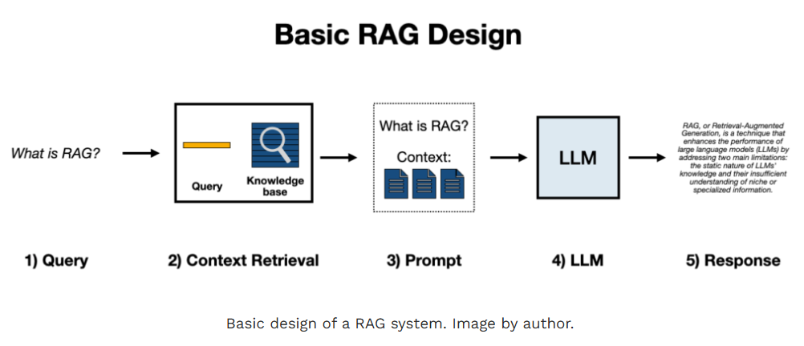
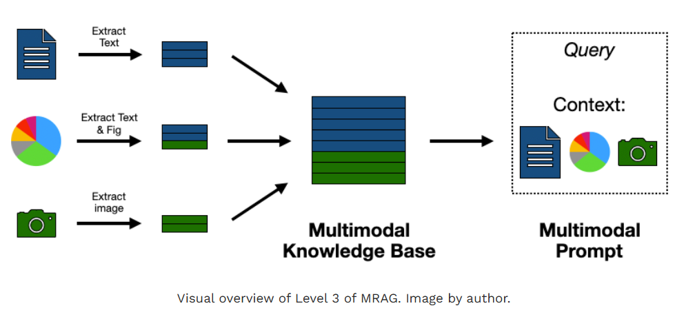
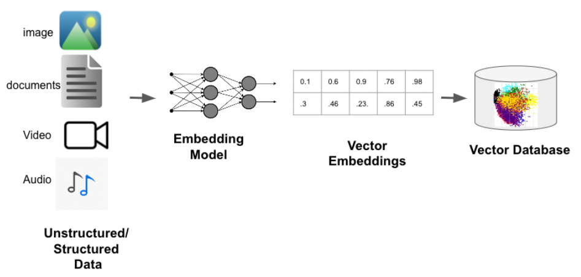
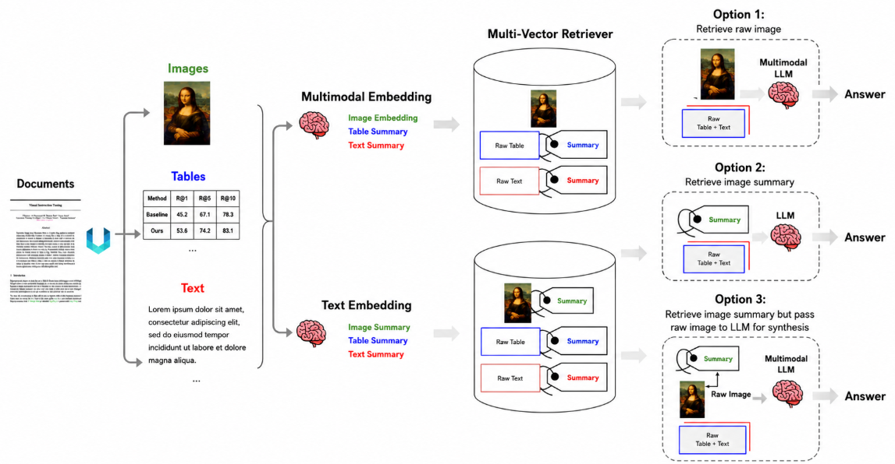
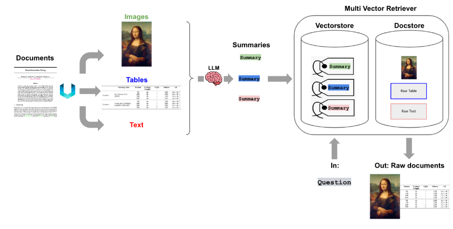

# [VLM with RAG](https://pyimagesearch.com/2026/07/12/building-multimodal-ai-applications-with-gemma-4-and-transformers/)

---
## [Gemma 4 VL이란?](https://medium.com/online-inference/training-and-deploying-vlm-models-with-gemma-4-c5dc1179833c)
- Google이 공개한 멀티모달 모델 — 이미지·비디오·오디오를 **네이티브로 처리**
- E2B / E4B 변형 제공 — 스마트폰부터 GPU 서버까지 배포 가능한 경량 크기
- `transformers` 라이브러리로 바로 로드해 실습 가능 (API 비용 없이)

```python
from transformers import AutoModelForMultimodalLM, AutoProcessor

model_id = "google/gemma-4-E2B-it"
model = AutoModelForMultimodalLM.from_pretrained(model_id, device_map="auto")
processor = AutoProcessor.from_pretrained(model_id)
```

> 이 강의의 예제 코드는 `gemma-4-E2B-it` 기준으로 작성 (로컬 GPU 없어도 실습 가능한 크기)

---
## Gemma 4 VL 아키텍처
- **Vision Encoder**: 이미지를 밀집 임베딩(dense embedding)으로 변환
- **Projector(멀티모달 커넥터)**: 비전 임베딩을 LLM이 이해하는 토큰 공간으로 매핑
- **LLM**: 텍스트 토큰 + 시각 토큰을 함께 받아 응답 생성

```
[이미지] ──▶ Vision Encoder ──▶ Projector ──▶ (시각 토큰)
                                                   │
[텍스트] ──▶ Tokenizer ───────────────────────▶ (텍스트 토큰)
                                                   │
                                                   ▼
                                              LLM (Decoder)
                                                   │
                                                   ▼
                                              텍스트 응답
```

> Vision Encoder가 만드는 "밀집 임베딩"이 곧 RAG에서 검색에 쓰는 이미지 벡터의 원천

---
## Qwen3-VL vs Gemma 4 VL
- 공통점: 둘 다 **Vision Encoder + Projector + LLM** 구조의 VLM
- 차이점: Qwen3-VL은 로컬 실습 편의성(Ollama)에, Gemma 4 VL은 임베딩 추출 및 `transformers` 생태계 연동(Vector DB 연계)에 강점
- 실무에서는 두 계열 모두 후보로 두고, **PoC 단계에서 벤치마크(응답 정확도·지연 시간·비용) 비교 후 선택**

---
| 구분 | Qwen3-VL (지난 시간) | Gemma 4 VL (이번 시간) |
|---|---|---|
| 개발사 | Alibaba Qwen 팀 | Google |
| 지원 모달리티 | 이미지, 텍스트 | 이미지, 비디오, 오디오, 텍스트 |
| 실행 방식 | Ollama (로컬 온디바이스) | `transformers` (`AutoModelForMultimodalLM`) |
| 모델 크기 | 2B ~ 235B, Instruct/Thinking 변종 | E2B / E4B, 모바일~GPU 서버 배포 |
| 이번 강의에서의 역할 | 프롬프트 엔지니어링 실습 | RAG 파이프라인의 임베딩·QA 실습 |

---
# [1. 기존 RAG vs Multimodal RAG](https://towardsdatascience.com/multimodal-rag-process-any-file-type-with-ai-e6921342c903/)

---
## 기존 Retrieval Augmented Generation
- 검색으로 찾은 근거를 LLM에 함께 전달해 답변 생성
- 처리 과정
  1. 문서를 청크(chunk) 단위로 분할
  2. 각 청크를 **텍스트 임베딩**으로 변환해 Vector DB에 저장
  3. 질문이 들어오면 질문도 임베딩 → 유사한 청크 Top-K 검색
  4. 검색된 청크 + 질문을 LLM에 전달 → 답변 생성

```
[문서] ──▶ 청크 분할 ──▶ 텍스트 임베딩 ──▶ Vector DB 저장
                                                   │
[질문] ──▶ 질문 임베딩 ──▶ 유사 청크 검색(Top-K) ◀──┘
                              │
                              ▼
                  검색된 청크 + 질문 ──▶ LLM ──▶ 답변
```

---


---
## 기존 RAG의 한계
- 문서를 **텍스트로만 추출**하기 때문에 표·차트·이미지에서 정보가 손실됨
  - 표를 텍스트로 뽑으면 행/열 구분이 무너져 숫자가 뒤섞임
  - 차트는 텍스트 추출 자체가 거의 불가능 (수치가 그림 안에 있음)
  - 스캔된 이미지 문서는 OCR 품질에 따라 정확도가 크게 흔들림
- 즉, "레이아웃 정보"와 "시각 정보"가 파이프라인에서 사라짐

> 보고서/논문/슬라이드처럼 표·그림 비중이 높은 문서일수록 기존 RAG의 정확도가 떨어짐

---
## Multimodal RAG란?
- 기존 텍스트 RAG의 한계를 보완 — **이미지/표/차트까지 임베딩**하여 검색 대상에 포함
  - 텍스트로 옮기며 손실되는 레이아웃·시각 정보를 그대로 보존
- 검색된 이미지/텍스트를 함께 VLM에 전달해 답변 생성

```
[질문] ──▶ 질문 임베딩
              │
              ▼
   Vector DB에서 유사 이미지·텍스트 검색 (Top-K)
              │
              ▼
   검색 결과(이미지+텍스트) + 질문 ──▶ VLM ──▶ 답변
```

> 일반 RAG가 "텍스트 창고"라면, Multimodal RAG는 "이미지·표·차트까지 포함한 창고"

---


---
## 기존 RAG vs Multimodal RAG

| 구분 | 기존 RAG | Multimodal RAG |
|---|---|---|
| 검색 대상 | 텍스트 청크만 | 텍스트 + 이미지 + 표 |
| 표/차트 처리 | 텍스트 변환 과정에서 정보 손실 | 이미지 그대로 보존 (또는 요약 후 원본 연결) |
| 임베딩 모델 | 텍스트 임베딩 모델 1종 | 텍스트·이미지가 같은 벡터 공간에 있는 멀티모달 임베딩 |
| LLM에 전달하는 것 | 텍스트만 | 텍스트 + 이미지 |
| 적합한 문서 | 순수 텍스트 문서 | 표/차트/이미지가 많은 보고서·논문·슬라이드 |

---
# [2. 이미지 임베딩과 Vector DB](https://zilliz.com/learn/what-are-binary-vector-embedding)

---


---
## 이미지 임베딩 (Image Embedding)
- Multimodal RAG의 핵심 재료 — Vision Encoder 출력을 **고정 길이 벡터**로 변환
- 텍스트 임베딩과 **같은 벡터 공간**에 놓이도록 학습된 모델을 사용해야 텍스트-이미지 교차 검색이 가능
- 대표 모델: CLIP 계열, SigLIP, Gemma 4의 Vision Encoder 출력 활용

```python
import torch

image = load_image("product.jpg")
inputs = processor(images=image, return_tensors="pt")

with torch.no_grad():
    vision_outputs = model.get_image_features(**inputs)

embedding = vision_outputs.mean(dim=1)  # (1, hidden_dim) 벡터로 축약
```

---
## Vector DB에 저장
- Vector DB(예: Chroma, FAISS, Milvus)에 이미지 임베딩 + 메타데이터를 함께 저장
- 메타데이터: 원본 파일 경로, 페이지 번호, 캡션, 카테고리 등 → 검색 결과 해석에 필수

```python
import chromadb

client = chromadb.Client()
collection = client.create_collection("product_images")

collection.add(
    ids=["img_001"],
    embeddings=[embedding.tolist()],
    metadatas=[{"path": "product.jpg", "category": "shoes"}],
)
```

---
## Similarity Search
- 벡터 간 유사도를 계산해 가장 가까운 K개를 반환 (보통 **Cosine Similarity**)
- 데이터가 많아지면 완전탐색(Brute-force) 대신 **ANN(근사 최근접 이웃)** 인덱스 사용
  - 대표 알고리즘: HNSW, IVF
  - 정확도와 속도를 트레이드오프 — 실무에서는 근사 검색으로 충분한 경우가 많음

```python
results = collection.query(
    query_embeddings=[query_embedding.tolist()],
    n_results=5,
)
```

---
## 이미지 검색 실전 활용
- 텍스트 질문 → 질문을 임베딩 → 이미지 벡터와 비교(텍스트-이미지 교차 검색)
- 예시: 이커머스 "이 색상, 이 디자인과 비슷한 상품 찾아줘"

```text
[사용자 업로드 이미지] ──▶ 이미지 임베딩 ──▶ Vector DB 유사도 검색
                                                     │
                                                     ▼
                                        유사 상품 이미지 Top-5 반환
```

> 검색 정확도는 임베딩 모델의 품질에 크게 좌우됨 — 도메인 특화 파인튜닝 시 정확도 상승

---
# [3. Multimodal RAG 파이프라인 구현](https://medium.com/@ashutoshsharmaengg/revolutionizing-ai-a-deep-dive-into-building-multimodal-rag-3cb4aa756dcc)

---
## Multimodal RAG 구현 3가지 옵션

| 옵션 | 검색 대상 | LLM에 전달하는 내용 | 특징 |
|---|---|---|---|
| ① 직접 임베딩 | 이미지·텍스트 원본 임베딩 | 원본 그대로 | 구현 간단, 이미지 임베딩 품질에 검색 정확도 좌우됨 |
| ② 요약만 임베딩 | 이미지 → 텍스트 요약 임베딩 | 요약 텍스트만 | 검색은 정확해지지만 **원본 시각 정보가 손실** |
| ③ 요약 임베딩 + 원본 검색 | 이미지 → 텍스트 요약 임베딩 | 검색된 요약의 **원본**(이미지) | 검색 정확도(텍스트) + 응답 품질(원본) 둘 다 확보 |

>  이 강의에서는 **③번(Multi-Vector Retriever 패턴)** 을 기준으로 실습 — 요약은 검색 전용, 원본은 답변 생성 전용으로 역할을 분리

---


---
## [③번(Multi-Vector Retriever 패턴)](https://www.langchain.com/blog/semi-structured-multi-modal-rag)
- **Vector Store**: 요약 텍스트의 임베딩만 저장 (검색 전용)
- **Document Store**: 원본 이미지/텍스트를 `doc_id` 기준으로 보관 (답변 생성 전용)
- 검색 시 요약으로 매칭 → 매칭된 `doc_id`로 원본을 꺼내 VLM에 전달

---


---
## PDF 검색
- PDF를 텍스트로만 추출하면 **표/그림/레이아웃 정보가 소실**
- 해결책: PDF **각 페이지를 이미지로 렌더링** → 이미지 임베딩으로 색인
- 질문이 들어오면 질문 임베딩과 가장 유사한 페이지(이미지)를 검색 → 해당 페이지 이미지를 VLM에 전달

```python
from pdf2image import convert_from_path

pages = convert_from_path("report.pdf", dpi=150)
page_embeddings = [embed_image(page) for page in pages]
# page_embeddings를 Vector DB에 저장 → 질문 시 유사도 검색
```

> 텍스트 추출 라이브러리(PyPDF 등)와 병행하면 "텍스트 정확도 + 레이아웃 보존"을 모두 확보

---
## Hybrid Search
- **텍스트 임베딩 검색 + 이미지 임베딩 검색**을 함께 수행해 결과를 결합
- 순수 텍스트 질문(예: "매출 증가율은?")과 순수 시각 질문(예: "빨간색 제품 찾아줘")이 섞인 실무 환경에 대응
- 결합 방식
  - 스코어 합산(Weighted Sum): `score = α·text_score + (1-α)·image_score`
  - 재순위화(Re-ranking): 1차 후보를 모아 VLM으로 최종 순위 재조정

```
텍스트 질문 ──▶ 텍스트 임베딩 검색 ──┐
                                    ├─▶ 결과 병합/재순위 ──▶ Top-K
이미지 유사 검색 ──▶ 이미지 임베딩 검색 ─┘
```

---
# 4. 문서 질의응답
- PDF QA
- 이미지 QA
- 표 질의응답

---
## PDF QA
- Multimodal RAG로 검색된 **관련 페이지 이미지**를 VLM에 전달해 답변 생성
- 여러 페이지가 검색될 경우, 페이지 순서와 출처(페이지 번호)를 함께 제시하도록 프롬프트 설계

```text
아래는 문서에서 검색된 관련 페이지 3장이야.
각 페이지 번호를 인용하며 "연간 매출 목표"가 얼마인지 답해줘.
문서에 없으면 "해당 정보 없음"이라고 답해.
```

---
## 이미지 QA
- 단일 이미지에 대한 질의응답 — 검색 없이 바로 VLM에 이미지+질문 전달
- RAG와 결합 시: 유사 이미지들을 함께 컨텍스트로 제공해 **비교 질의**도 가능

```text
[검색된 유사 이미지 3장] + 질문:
"이 중에서 재고 이미지와 가장 비슷한 디자인은 몇 번째 이미지야?
 다른 점이 있다면 함께 설명해줘."
```

---
## 표 질의응답
- 표는 페이지 이미지 검색만으로는 셀 단위 정확도가 떨어질 수 있음
- 전략: 표를 **마크다운으로 변환한 텍스트본**과 **원본 이미지**를 함께 검색·전달
  - 텍스트본 → 정확한 셀 값 조회
  - 원본 이미지 → 레이아웃/서식 확인 및 텍스트본 검증

```text
검색된 표(마크다운 변환본)와 원본 이미지를 함께 참고해서,
"2024년" 열에서 가장 큰 값을 가진 행을 알려줘.
변환 과정에서 누락된 값이 있어 보이면 원본 이미지 기준으로 정정해줘.
```
