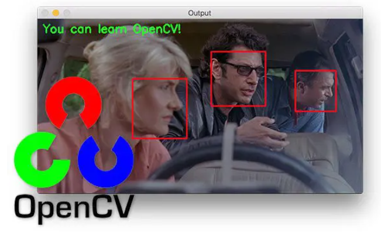
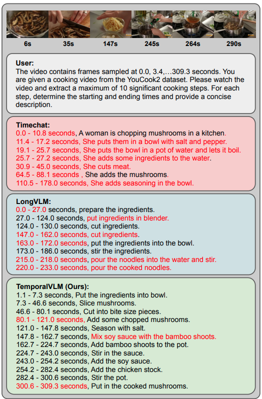

# Video Language Model

---

## 이미지 VLM
- **정지 이미지** 이해 (캡셔닝, OCR, 문서/차트 분석, Multimodal RAG)
- 이미지는 "한 장의 정보" — 모델이 한 번에 전체를 보고 답하면 됨

## 영상은 다르다
- 영상 = **시간 축(Temporal)** 이 추가된 이미지의 연속
- "무엇이 보이는가"뿐 아니라 "무엇이 어떻게 변하는가/일어났는가"까지 이해해야 함
- 초당 24~30장의 프레임 × 수 분 = 수만 장의 이미지 → **그대로 다 넣을 수 없음**

> 핵심 질문: **영상을 어떻게 잘라서, 얼마나, 어떤 순서로 VLM에 넣을 것인가**

---

# 1. 영상과 VLM
- 이미지 VLM vs Video VLM
- 영상 이해의 난제
- Video VLM 아키텍처 3가지 패턴

---

## 이미지 VLM vs Video VLM

| 구분 | 이미지 VLM | Video VLM |
|---|---|---|
| 입력 | 정지 이미지 1장(또는 여러 장) | 시간 순서가 있는 프레임 시퀀스 |
| 이해 대상 | 공간적 관계(무엇이 어디에 있는가) | 공간 + 시간적 관계(무엇이 어떻게 변하는가) |
| 토큰 비용 | 이미지 1장 = 고정 토큰 | 프레임 수에 비례 → 쉽게 폭발 |
| 대표 태스크 | 캡셔닝, OCR, VQA | 요약, 이벤트 탐지, 행동 인식 |

---

## 영상 이해의 난제
- **프레임 수 vs 컨텍스트 길이**: 1분 영상(30fps) = 1,800프레임 → 전부 넣으면 토큰 한도 초과
- **정보 손실**: 프레임을 듬성듬성 뽑으면(sampling) 짧은 이벤트를 놓칠 수 있음
- **로컬 모델의 한계**: Qwen3-VL(Ollama)은 영상 파일을 직접 받지 않음 → **프레임 이미지로 변환해서 전달**해야 함

> "토큰" 개념이 영상에서는 훨씬 더 중요해짐 — 프레임 수 = 토큰 비용

---

## Video VLM 아키텍처 3가지 패턴

| 패턴 | 방식 | 대표 |
|---|---|---|
| ① Frame Sampling | 프레임을 균등/장면 기반으로 뽑아 이미지 여러 장으로 전달 | 로컬 VLM(Qwen3-VL 등), 대부분의 오픈소스 |
| ② Native Video Encoder | 시공간(spatio-temporal) 토큰을 압축하는 전용 인코더 내장 | Gemini, Qwen2.5-VL(video 모드) |
| ③ 오디오 결합 | 프레임 이해 + STT(음성 인식) 트랜스크립트를 함께 활용 | 자막/강의 영상 등 |

> 이 강의는 로컬 환경(Ollama + Qwen3-VL) 기준이므로 **① Frame Sampling 방식**을 실습 기준으로 함

---
# [2. 영상 입력 처리 (OpenCV 연계)](https://pyimagesearch.com/2018/07/19/opencv-tutorial-a-guide-to-learn-opencv/)
- 영상 메타데이터 읽기
- Frame 추출 전략
- 전처리와 프레임 수 결정
- VLM에 프레임 전달하기

---


---
## 영상 메타데이터 읽기
- OpenCV `VideoCapture`로 fps, 총 프레임 수, 해상도, 재생 시간 확인
- 샘플링 전략을 정하기 전에 반드시 먼저 확인해야 하는 값들

```python
import cv2

cap = cv2.VideoCapture("video.mp4")
fps = cap.get(cv2.CAP_PROP_FPS)
frame_count = cap.get(cv2.CAP_PROP_FRAME_COUNT)
duration_sec = frame_count / fps
width, height = cap.get(cv2.CAP_PROP_FRAME_WIDTH), cap.get(cv2.CAP_PROP_FRAME_HEIGHT)
```

---

## Frame 추출 전략 비교

| 전략 | 방식 | 장점 | 단점 |
|---|---|---|---|
| 균등 샘플링(Uniform) | N등분해서 일정 간격으로 추출 | 구현 간단, 전체 흐름 파악에 유리 | 짧은 이벤트를 놓칠 수 있음 |
| 장면전환 감지(Scene-change) | 프레임 간 픽셀/히스토그램 차이가 클 때만 추출 | 컷이 바뀌는 지점을 놓치지 않음 | 정적인 장면에서는 프레임이 거의 안 뽑힘 |
| 고정 fps 샘플링 | 예: 1초에 1장씩 추출 | 시간 간격이 균일해 타임스탬프 매핑이 쉬움 | 영상 길이에 비례해 프레임 수 증가 |

> 실무에서는 **고정 fps 샘플링**을 기본값으로 하고, 이벤트 탐지처럼 정밀도가 필요하면 장면전환 감지를 보조로 사용

---

## 전처리와 프레임 수 결정
- Resize: VLM 입력 해상도에 맞춰 축소(속도·비용 절감, 과도한 축소는 텍스트/디테일 손실)
- **프레임 수 = 토큰 비용** → 몇 장을 넣을지가 정확도와 속도의 트레이드오프

| 프레임 수 | 특징 |
|---|---|
| 4~8장 | 빠르고 저렴, 짧은 영상 요약에 적합, 세부 이벤트 놓치기 쉬움 |
| 16~32장 | 정확도와 비용의 균형, 대부분의 실습에 권장 |
| 32장 이상 | 정밀하지만 느리고 비용 증가, 긴 영상엔 비효율적 |

---

## VLM에 프레임 전달하기
- Ollama `chat`의 `images`는 리스트 → **한 메시지에 여러 프레임을 순서대로 담아 전달**
- 프롬프트에 "프레임 순서" 또는 "N초 지점"을 명시해야 모델이 시간 순서를 인지

```python
response = ollama.chat(
    model="qwen3-vl:4b",
    messages=[{
        "role": "user",
        "content": "아래는 영상에서 0.5초 간격으로 추출한 프레임 1~8번이야. 시간 순서대로 무슨 일이 일어나는지 설명해줘.",
        "images": [f1, f2, f3, f4, f5, f6, f7, f8],
    }],
)
```

---
# [3. Temporal Reasoning (시간적 추론)](https://retrocausal.ai/wp-content/TemporalVLM.html)
- 순서 · 변화 · 인과 추론
- 타임스탬프 Grounding
- 실패 사례와 한계
- 구조화된 타임라인 출력



---

## 순서 · 변화 · 인과 추론
- 단일 프레임 질의: "이 이미지에 뭐가 있어?"
- Temporal Reasoning: "**무엇이 먼저고 무엇이 나중인지**", "**무엇이 바뀌었는지**", "**왜 이런 일이 일어났는지**"
- 대표 태스크: 순서 판단, 변화(diff) 감지, 이벤트 경계(boundary) 탐지

```text
[나쁜 예] 이 영상에 뭐가 나와?
[좋은 예] 프레임 1번부터 8번까지 순서대로 봤을 때,
         등장인물의 행동이 어떻게 바뀌는지 시간 순서대로 설명해줘.
```

---

## 타임스탬프 Grounding
- 프레임에 "몇 번째" 대신 "**몇 초 지점**"을 명시하면 답변에 시간 정보가 딸려 나옴 → 이후 이벤트 탐지에 필수
- 프롬프트에 각 프레임의 타임스탬프를 명시적으로 나열해 전달

```text
아래 프레임은 각각 0초, 2초, 4초, 6초, 8초 지점이야.
공이 골대에 들어가는 순간이 몇 초 지점인지 알려줘.
```

---

## 실패 사례와 한계
- **샘플링 간격보다 빠른 이벤트**: 프레임 사이에서 일어난 일은 아예 못 봄 (예: 8초 안에 스쳐 지나간 사건)
- **환각(Hallucination)**: 실제로 없는 사건을 "봤다"고 답하는 경우 — 특히 프레임 수가 적을 때 심함
- **오디오 정보 부재**: 대사·음악·효과음은 프레임에 없음 → 오디오 의존 콘텐츠는 파악 불가

> 대응: "제공된 프레임에서 확인되지 않으면 추측하지 말고 '확인 불가'라고 답해"를 프롬프트에 명시

---

## 구조화된 타임라인 출력
- 이벤트 탐지 결과를 후속 처리 가능한 형태로 고정

```json
{
  "events": [
    {"timestamp_sec": 4, "event": "goal", "description": "공이 골대 오른쪽으로 들어감"},
    {"timestamp_sec": 12, "event": "celebration", "description": "선수들이 환호"}
  ]
}
```

---

# 4. Video AI 실습 태스크
- 영상 요약
- 이벤트 탐지
- 행동 분석

---

## 영상 요약 (Video Summarization)
- 균등 샘플링한 프레임 전체를 한 번에 전달 → 전체 줄거리/핵심 장면 요약
- 프롬프트 설계: 요약 길이, 시청자 대상(예: "3줄 요약"), 핵심 장면 선정 기준 명시

```text
아래 프레임들은 영상 전체를 균등한 간격으로 추출한 것이야.
이 영상에서 일어나는 일을 시간 순서대로 3~4문장으로 요약해줘.
```

---

## 이벤트 탐지 (Event Detection)
- "특정 사건이 몇 초에 일어났는가"를 찾는 태스크 → 3강에서 배운 구조화된 출력과 결합
- 스포츠 하이라이트, CCTV 특이사항, 강의 챕터링 등에 응용

```text
아래 프레임들에서 "문이 열리는 순간"이 몇 초 지점인지 찾아서
{"timestamp_sec": number, "description": string} 형식의 JSON으로만 답해.
```

---

## 행동 분석 (Action Recognition)
- 사람/사물의 동작을 분류하거나, 평소와 다른 행동(이상행동)을 탐지
- CCTV 이상행동 탐지처럼 "정상 범주"를 프롬프트에 정의해주면 정확도 상승

```text
아래는 CCTV 영상에서 추출한 프레임이야.
정상적인 보행 외에 넘어짐, 배회, 물건 방치 같은 이상행동이
보이면 몇 번째 프레임에서 어떤 행동인지 설명해줘. 없으면 "이상없음"이라고 답해.
```

---

# 5. 긴 영상 다루기 — Video RAG
- 문제: 토큰 한계
- 클립 분할과 요약 임베딩
- Video RAG 파이프라인
- 이미지 RAG와의 차이

---

## 문제: 토큰 한계
- 10분 이상 영상은 프레임을 아무리 듬성듬성 뽑아도 한 번에 다 넣기 어려움
- 3강에서 "PDF를 페이지 단위로 쪼개 검색"했던 것처럼, 영상도 **구간(클립) 단위로 쪼개서 검색**해야 함

---

## 클립 분할과 요약 임베딩
- 영상을 고정 길이(예: 30초) 또는 장면전환 기준 **클립 단위**로 분할
- 각 클립에서 대표 프레임을 뽑아 VLM으로 **텍스트 요약** 생성 → 요약을 임베딩해 Vector DB에 저장
- 3강의 **Multi-Vector Retriever 패턴** 그대로 재사용
  - Vector Store: 클립 요약의 임베딩 (검색 전용)
  - Document Store: 클립의 원본 프레임들 (답변 생성 전용)

---

## Video RAG 파이프라인

```
[영상] ──▶ 클립 분할(30초 단위) ──▶ 클립별 대표 프레임 추출
                                          │
                                          ▼
                              VLM으로 클립 요약 생성
                                          │
                                          ▼
                        요약 임베딩 → Vector DB 저장 (clip_id 매핑)
                                          │
[질문] ──▶ 질문 임베딩 ──▶ 유사 클립 검색(Top-K) ──▶ clip_id로 원본 프레임 조회
                                                              │
                                                              ▼
                                          검색된 프레임 + 질문 ──▶ VLM ──▶ 답변
```

---

## 이미지 RAG와의 차이
- 검색 결과가 여러 개일 때, **시간 순서를 보존**해서 프롬프트에 전달해야 함 (이미지 RAG는 순서 무관)
- 인접 클립 간 맥락이 이어지는 경우가 많아 **Top-K 클립 + 전후 클립**을 함께 전달하면 답변 품질 상승

> "K번째 클립"이 아니라 "N분 M초 구간"으로 답변하도록 프롬프트에 명시 — 사용자가 실제 영상에서 바로 확인 가능

---

# 6. 실전 활용과 한계
- 대표 Use Case
- 트레이드오프
- 한계

---

## 대표 Use Case
- **보안/CCTV**: 이상행동 탐지, 특정 시간대 이벤트 검색
- **스포츠**: 하이라이트 구간 자동 탐지
- **교육**: 강의 영상 챕터 자동 분할 및 요약
- **콘텐츠 모더레이션**: 부적절한 장면 탐지

---

## 트레이드오프

| 요소 | 늘리면 | 줄이면 |
|---|---|---|
| 프레임 수 | 정확도 ↑, 비용/지연시간 ↑ | 속도 ↑, 짧은 이벤트 놓칠 위험 ↑ |
| 클립 길이(Video RAG) | 검색 정확도 ↓ (클립이 뭉뚱그려짐) | 클립 수 ↑ → 임베딩/저장 비용 ↑ |

---

## 한계
- **오디오 정보 부재**: 프레임 기반 VLM은 소리를 못 봄 → 대사 중심 콘텐츠는 STT 결합 필요
- **빠른 모션**: 샘플링 간격보다 빠른 동작은 인식 불가
- **비용**: 긴 영상을 자주 분석해야 하는 경우 클립 캐싱/사전 인덱싱 전략 필수

