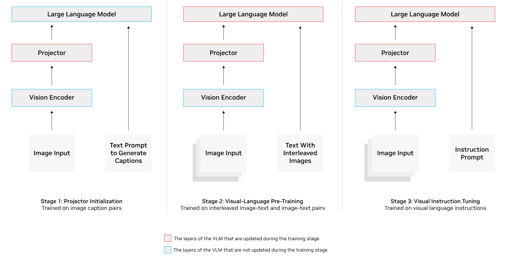
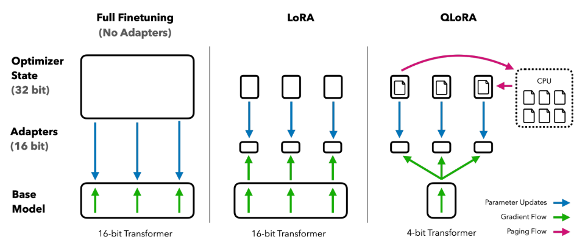
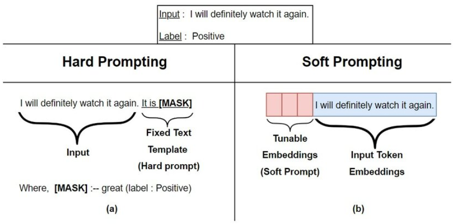
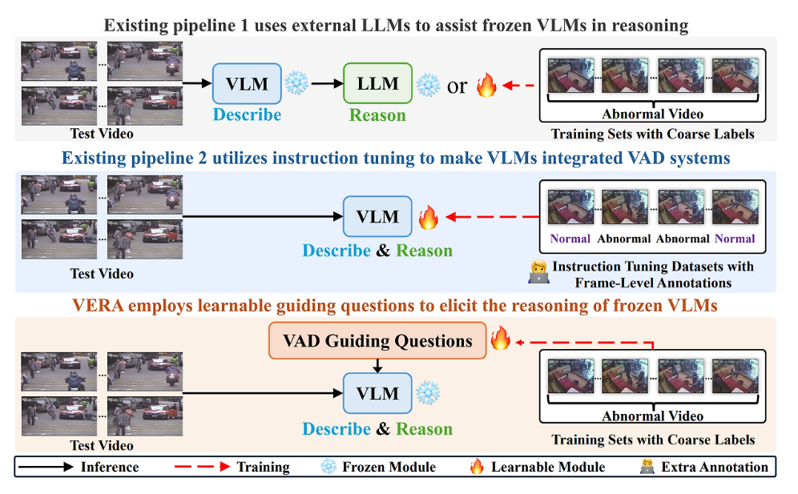
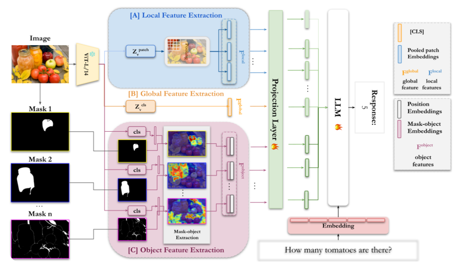

# VLM Fine Tuning

---
# 1. Fine-tuning이 필요한 경우

---

## 추론 시점 기법의 한계

| 문제 상황 | 프롬프트/RAG로 해결 가능? |
|---|---|
| 모델이 모르는 최신/사내 지식이 필요 | O — RAG로 문서 주입 |
| 답변 형식(JSON 등)을 지켜야 함 | 대체로 O — 프롬프트로 유도 |
| 특정 도메인 이미지의 **미묘한 패턴**을 인식해야 함 (예: 특정 불량 유형, 특정 화풍) | X — 말로 설명하기 어려움 |
| 항상 같은 톤·형식의 답변을 **높은 일관성**으로 내야 함 | 제한적 — 프롬프트만으로는 흔들림 |

> 프롬프트로 "설명"할 수 없는 패턴이거나, 매번 같은 지시를 반복해야 한다면 fine-tuning을 고려

---

## Fine-tuning을 고려해야 하는 신호
- 프롬프트를 아무리 정교하게 짜도 **정확도가 일정 수준 이상 오르지 않음**
- 같은 형식의 데이터가 **충분히 많이 축적**되어 있음 (수백~수천 건 이상)
- 서비스가 **특정 도메인에 고정**되어 범용성보다 정확도·일관성이 중요
- 매 요청의 프롬프트 길이(토큰 비용)를 줄여야 하는 대량 트래픽 서비스

> 반대로 데이터가 적거나, 요구사항이 자주 바뀌는 초기 단계라면 RAG/프롬프트가 더 합리적

---

## 방법론 선택 기준

| 구분 | 핵심 질문 | 대표 선택지 |
|---|---|---|
| 목적 | 모델이 어떤 문제를 해결해야 하는가? | 외부 지식 → RAG, 답변 행동 → Instruction Tuning |
| 방식 | 제한된 GPU로 어떻게 학습할 것인가? | Full Fine-tuning, LoRA, QLoRA |
| 대상 | 모델의 어느 부분을 학습할 것인가? | Projector, LLM 일부, Vision Adapter |
| 평가 | 실제로 좋아졌는지 어떻게 확인할 것인가? | Held-out 평가셋, 전후 비교, 회귀 체크 |

---
# 2. VLM 학습 데이터 구조

---
## Instruction-following 데이터 포맷
- LLM의 instruction tuning 데이터(`instruction` - `input` - `output`) 구조에 **이미지**가 추가된 형태
- 대화형(conversation) 포맷이 표준 — 여러 턴의 Q&A를 하나의 샘플로 구성 가능

```json
{
  "image": "images/0001.jpg",
  "conversations": [
    {"from": "human", "value": "<image>\n이 제품 사진에서 불량 부위를 찾아줘."},
    {"from": "gpt", "value": "우측 상단 모서리에 스크래치가 있습니다."}
  ]
}
```

---
## 이미지-텍스트 페어 구성
- **캡션형**: 이미지 1장 + 설명 1개 — 가장 단순, VQA/캡셔닝 기초 학습에 사용
- **대화형**: 이미지 1장 + 여러 턴의 Q&A — 실제 서비스 시나리오에 가까움
- **비교/근거형**: 이미지 + 정답 + "왜 그런지"에 대한 근거(rationale) — 판단 근거를 함께 학습시켜 신뢰도 향상

| 유형 | 장점 | 단점 |
|---|---|---|
| 캡션형 | 제작 쉬움 | 실제 질의응답 패턴과 거리 있음 |
| 대화형 | 서비스 패턴과 유사 | 제작 비용 높음(멀티턴 라벨링) |
| 근거형 | 설명 가능성 확보 | 라벨러의 근거 작성 부담 큼 |

---
## 데이터 품질 체크리스트
- **다양성**: 같은 유형의 이미지/질문만 반복되면 과적합(특정 패턴만 암기)
- **일관성**: 같은 상황에 다른 정답 포맷이 섞이면 학습이 흔들림
- **정답 검증**: 라벨링 오류가 소수만 섞여도 fine-tuning 품질에 큰 영향
- **클래스 불균형**: 특정 케이스(예: "이상없음")가 과도하게 많으면 편향 학습
- **평가셋 선분리**: 학습 전에 train/val/test를 먼저 나누고, 무엇을 성공으로 볼지 기준을 정해야 함

> 데이터 100건을 정제하는 것이, 1,000건을 대충 모으는 것보다 나은 경우가 많음

> 실습: 노트북 1(`1. VLM 학습 데이터 준비.ipynb`)에서 위 포맷과 체크리스트를 직접 코드로 확인

---
# 3. 학습 목적: Instruction Tuning

---
## 개념과 목적
- 사전학습(pretraining)된 VLM에 **"지시를 따르는 방식"** 을 가르치는 후속 학습 단계
- 목표: 새로운 지식 주입이 아니라, **원하는 형식·태도로 답하도록 정렬(align)**
- Instruction Tuning은 **학습 목적/데이터 방식**이고, LoRA/QLoRA는 이를 **적은 자원으로 수행하는 학습 방식**
- Full fine-tuning(전체 파라미터 학습)은 VLM 규모에서는 비용·메모리 부담이 매우 큼

---
## [VLM 구조에서 무엇을 학습시키는가](https://www.nvidia.com/en-eu/glossary/vision-language-models/)

VLM은 보통 **Vision Encoder + Projector(연결부) + LLM** 3부분으로 구성

| 구성요소 | 역할 | Instruction Tuning에서 |
|---|---|---|
| Vision Encoder | 이미지를 임베딩으로 변환 | 보통 **freeze**(동결) — 이미 잘 학습되어 있음 |
| Projector | 이미지 임베딩을 LLM 입력 공간으로 매핑 | **학습 대상** — 새 도메인 적응에 핵심 |
| LLM(언어모델) | 텍스트 생성 | 전체 또는 일부(LoRA)만 학습 |

---


---
## 단계별 요약
> 이 세 단계를 거치면 단순히 이미지를 설명하는 모델이 아니라, 이미지를 보고 질문에 답하고 추론까지 수행하는 VLM이 완성됩니다.

| 단계                                       | 학습 대상               | 입력 데이터                                  | 목적                             |
| ---------------------------------------- | ------------------- | --------------------------------------- | ------------------------------ |
| **Stage 1** Projector Initialization     | **Projector만**      | Image-Caption Pair                      | 이미지 특징을 LLM 임베딩 공간으로 변환        |
| **Stage 2** Visual-Language Pre-training | **Projector + LLM** | Image-Text Pair, Interleaved Image-Text | 이미지와 텍스트를 함께 이해하는 멀티모달 능력 학습   |
| **Stage 3** Visual Instruction Tuning    | **Projector + LLM** | Image + Instruction + Answer            | 사용자의 지시를 이해하고 자연스럽게 답변하는 능력 학습 |

---
# 4. 학습 방식: LoRA / QLoRA

---


---
| 색상     | 의미                            | Full FT       | LoRA                          | QLoRA                          |
| ------ | ----------------------------- | ------------- | ----------------------------- | ------------------------------ |
| 🔵 | Parameter Update(실제 가중치 업데이트) | Base Model 전체 | Adapter만                      | Adapter만                       |
| 🟢 | Gradient Flow(역전파)            | 전체            | Base Model을 통과하여 Adapter까지 전달 | Base Model을 통과하여 Adapter까지 전달  |
| 🩷 | Paging Flow                   | 없음            | 없음                            | GPU ↔ CPU 간 Optimizer State 이동 |

---
| 항목              | Full FT | LoRA       | QLoRA                            |
| --------------- | ---------------- | ---------- | -------------------------------- |
| Base Model 학습   | ✅                | ❌ | ❌                        |
| Adapter 사용      | ❌                | ✅          | ✅                                |
| Base Model 정밀도  | FP16/BF16        | FP16/BF16  | **4bit(NF4)**                    |
| Optimizer State | GPU              | GPU        | GPU + CPU Paging                 |
| GPU 메모리         | 매우 큼             | 작음         | 가장 작음                            |
| 학습 속도           | 느림               | 빠름         | 빠름                               |
| 대표 사용 환경        | 대규모 GPU 서버       | 일반 GPU     | 단일 GPU(24GB~48GB)에서도 대형 모델 학습 가능 |

---
# 5. 평가: Fine-tuning 결과 확인

---

## Loss만으로는 부족한 이유
- Training loss가 낮아졌다고 **실제 응답 품질이 좋아졌다는 보장은 없음**
- 데이터 양이 적을 때는 특정 패턴을 "이해"한 게 아니라 **암기**했을 가능성이 큼
- 최종적으로 확인해야 할 질문은 하나: **"실제 태스크에서 fine-tuning 전보다 더 나은 답을 내는가"**

> Loss 곡선은 학습이 "진행되고 있는지"를 보여줄 뿐, "쓸 만해졌는지"는 별도로 확인해야 함

---

## 평가셋 구성 원칙
- **Held-out**: 학습에 전혀 쓰지 않은 데이터로 평가 — train에 섞이면 암기 여부를 구분할 수 없음
- **분포 일치**: 실제 서비스에서 들어올 이미지/질문과 비슷한 비율로 구성(정상:불량 비율 등)
- **충분한 수**: 몇 장만으로는 우연히 맞은 것인지 실력인지 구분하기 어려움

| 항목 | 나쁜 예 | 좋은 예 |
|---|---|---|
| 데이터 출처 | train과 같은 소스에서 임의로 몇 장 추출 | 처음부터 train/val을 분리해서 수집 |
| 케이스 구성 | 쉬운 케이스만 포함 | 애매한 케이스·엣지 케이스도 포함 |

---

## 정량 평가 vs 정성 평가

| 구분 | 정량 평가 | 정성 평가 |
|---|---|---|
| 방법 | 정확도·포맷 준수율 등 수치로 집계 | 사람이 답변을 직접 읽고 판단 |
| 장점 | 빠르고 반복 가능, 자동화 가능 | 수치로 못 잡는 미묘한 오류 포착 |
| 단점 | 채점 기준이 단순하면 실제 품질과 괴리 가능 | 느리고 평가자마다 기준이 다를 수 있음 |

> 정량 평가로 큰 흐름을 빠르게 확인하고, 애매한 사례는 정성 평가로 보완하는 것이 일반적

---

## Fine-tuning 전후 비교
- 같은 평가셋에 **base 모델**과 **fine-tuned 모델**을 동일한 프롬프트로 돌려 결과를 나란히 비교

```text
base 모델 정확도:  OO%
QLoRA 모델 정확도: OO%
```

> 수치 차이뿐 아니라, 어떤 유형의 사례에서 개선/악화됐는지 같이 확인해야 원인을 파악할 수 있음

---

## 과적합·회귀(Regression) 체크
- **과적합**: 학습 데이터와 매우 비슷한 사례만 잘 맞히고, 조금만 달라져도 틀리는지 확인
- **회귀(catastrophic forgetting)**: fine-tuning 전에는 잘하던 일반적인 태스크(예: 일반 이미지 캡셔닝)를 fine-tuning 후에 못하게 되지 않았는지 확인
- 도메인 평가셋 + 기존 일반 태스크 평가셋을 **함께** 돌려보는 것이 안전

> Fine-tuning은 특정 태스크를 잘하게 만드는 대신, 다른 능력을 희생시킬 수 있다는 트레이드오프를 항상 확인할 것

---

# 6. 경량 적응 방법: Prompt Tuning / VERA

---

## Prompt Tuning 개념
- 모델 가중치는 전혀 건드리지 않고, **학습 가능한 프롬프트(soft prompt)** 벡터만 추가로 학습
- LoRA보다도 학습 파라미터가 훨씬 적음 — 그만큼 표현력도 제한적

| 구분 | 일반 프롬프트(하드 프롬프트) | Prompt Tuning(소프트 프롬프트) |
|---|---|---|
| 형태 | 사람이 읽을 수 있는 자연어 텍스트 | 학습으로 최적화된 임베딩 벡터 |
| 설계 방법 | 사람이 직접 문구를 고민 | 데이터로부터 경사하강법으로 학습 |
| 해석 가능성 | 높음 | 낮음(벡터라 사람이 읽을 수 없음) |
| 필요 자원 | 없음 | 소량의 학습 데이터·연산 |

---


---
## [VERA (Explainable Video Anomaly Detection via Verbalized Learning of VLMs)](https://smcho1201.tistory.com/146)

- 기존 방법 1: VLM이 설명하고 LLM이 추론한다. (LLM 추가 비용 발생)
- 기존 방법 2: VLM 자체를 Fine-tuning한다. (프레임 단위 라벨링 필요)
- VERA: VLM은 그대로(Frozen) 두고, 학습 가능한 Guiding Question만 추가하여 VLM이 **이상행동** 을 더 잘 설명하고 추론하도록 유도한다.

> VERA의 가장 중요한 아이디어는 "모델을 학습시키는 것이 아니라, 모델에게 던질 질문(Prompt)을 학습시킨다"는 점입니다. 

---


---
- `Guiding Questions`: Frozen VLM의 가중치를 변경하지 않고, VLM이 **이상행동** 에 집중하여 설명하고 추론하도록 유도하는 학습 가능한 프롬프트(Soft Prompt)
- `Coarse Label`: 세부 위치나 시점은 알려주지 않고, 전체 데이터에 대해서만 붙여진 라벨
- `Frame-level Annotation`: 영상의 각 프레임(Frame) 또는 매우 짧은 시간 구간마다 정답(Label)을 붙이는 작업

| 방법                  | VLM         | 추가 모델                     | 추가 데이터                    | 문제점         |
| ------------------- | ----------- | ------------------------- | ------------------------- | ----------- |
| Existing Pipeline 1 | Freeze      | LLM 필요                    | Coarse Label              | LLM 비용 증가   |
| Existing Pipeline 2 | Fine-tuning | 없음                        | Frame-level Annotation 필요 | 데이터 구축 비용 큼 |
| **VERA**            | **Freeze**  | **Guiding Questions만 학습** | **Coarse Label만 사용**      | 비용이 가장 적음   |

---
## Prompt Tuning vs LoRA

| 구분 | Prompt Tuning | LoRA |
|---|---|---|
| 학습 파라미터 | 매우 적음 | 적음 |
| 표현력 | 제한적(단순 태스크 적응) | 상대적으로 높음 |
| 다중 태스크 전환 | 프롬프트만 교체하면 됨(가벼움) | 어댑터 파일 교체 필요 |
| 적합한 상황 | 페르소나·톤 고정, 경량 개인화 | 도메인 지식/패턴 자체를 바꿔야 할 때 |

---
# 7. 학습 대상 확장: Vision Adapter
- Vision Adapter는 표준화된 하나의 모델 이름이 아니라 설계 방식(Design Pattern)을 가리키는 표현입니다.

> 따라서 Vision Adapter는 **Vision Encoder와 LLM을 연결하는 경량 연결 모듈을 학습하는 접근 방식** 입니다.

---

## Vision Adapter
- Vision Encoder와 LLM 사이를 연결하는 경량 모듈(Projector/Adapter)만 학습하는 방식
- Vision Encoder와 LLM의 사전학습된 가중치는 최대한 유지하고, 이미지-언어 정렬(Image-Language Alignment)을 위한 연결부만 업데이트
- 적은 학습 데이터와 GPU 메모리로 새로운 이미지 도메인(의료, 위성, 산업 검사 등)에 빠르게 적응 가능
- 대표 사례: [LLaVA](https://www.themoonlight.io/en/review/when-llava-meets-objects-token-composition-for-vision-language-models)
  - Stage 1: CLIP(Freeze) + Vicuna(Freeze), Projector만 학습
  - Stage 2: CLIP은 Freeze를 유지하고, Projector와 LLM을 함께 Visual Instruction Tuning

---



